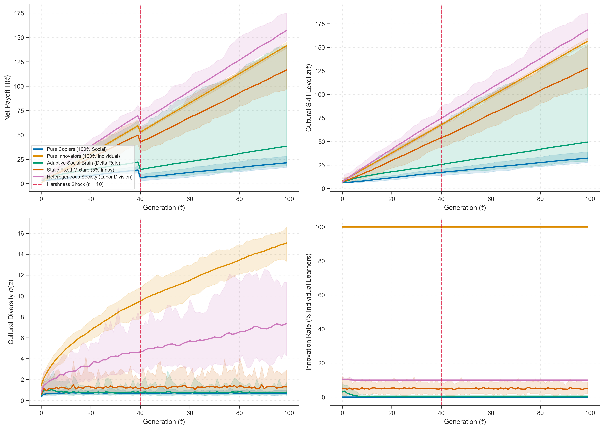
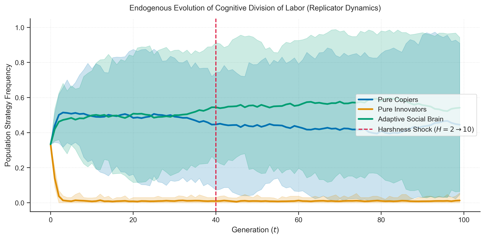
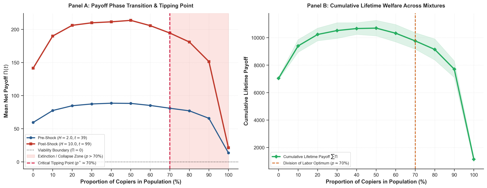
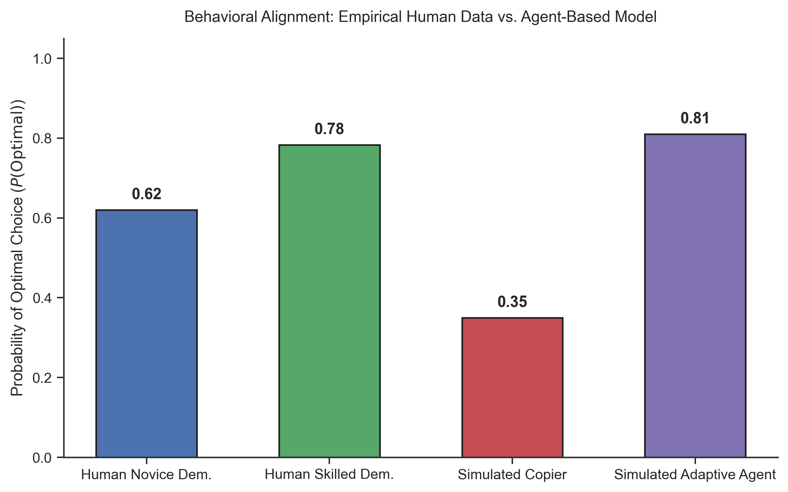
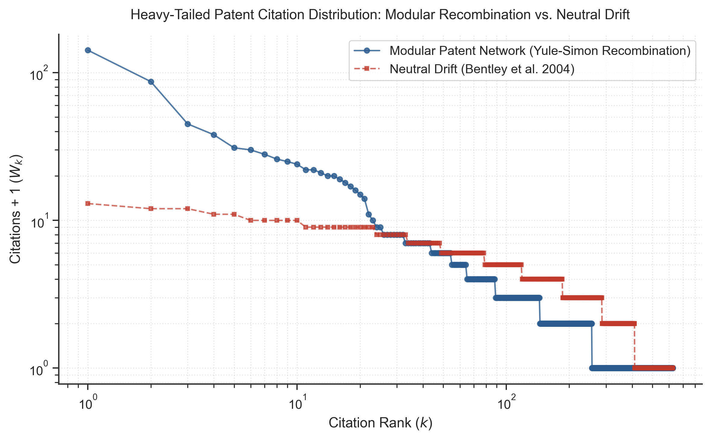

# The Pressure for Efficiency in Cumulative Cultural Evolution
### Resolving Rogers' Paradox via Adaptive Social Brains and Cognitive Division of Labor

[](https://www.python.org/)
[](https://github.com/rares8283682/cultural-evolution-efficiency/actions/workflows/ci.yml)
[](https://opensource.org/licenses/MIT)
[](https://www.i4replication.org/)
[](https://psl.eu/)
[](https://rares8283682.github.io/cultural-evolution-efficiency/)

---

## 📖 Executive Summary

Cumulative Cultural Evolution (CCE) has long been framed through **Rogers' Paradox (1988)**: in a homogeneous population, pure social learners (copiers) act as evolutionary parasites on individual innovators. Because copying is cheap, imitators multiply until cultural diversity degrades, mean fitness collapses, and the population's net payoff drops to that of a solitary individual learner.

This research project develops an agent-based computational framework operationalizing **Zipf's Principle of Least Effort** and **Prof. Alexey Koshevoy's Pressure for Efficiency** (Cognition 2023, TopiCS 2024, CogSci 2024). We demonstrate that:
1. **Adaptive Social Brains Resist Collapse**: Agents equipped with a dopaminergic Reward Prediction Error (Rescorla-Wagner $\Delta$-rule) dynamically gate social transmission versus innovation, avoiding catastrophic fitness crashes during environmental harshness shocks $H(t)$.
2. **Cognitive Division of Labor is an Evolutionary Stable Strategy (ESS)**: In an endogenous replicator dynamic, the population naturally partitions into a cooperative equilibrium: a majority of efficient copiers supported by an active minority of innovators and adaptive scouts.
3. **Empirical Validation**: Theoretical predictions align with $N = 9{,}600$ human behavioral choices from empirical two-armed bandit experiments under social observation ([Najar et al., 2020, *PLoS Biology*](https://doi.org/10.1371/journal.pbio.3000867)).
4. **Technological Recombination Extension**: Incorporating Mathieu Charbonneau's (2015, 2018) modular recombination framework reproduces real-world heavy-tailed patent citation distributions ($P(k) \propto k^{-\gamma}$).

> 🎮 **Try the Interactive Web Sandbox**: Run the 60 FPS agent-based simulation directly in your browser with real-time parameter sliders at **[rares8283682.github.io/cultural-evolution-efficiency](https://rares8283682.github.io/cultural-evolution-efficiency/)**.

---

## 🔬 Theoretical Framework & Mathematical Formulations

```
                  ┌────────────────────────────────────────────────────────┐
                  │             Environmental Harshness H(t)               │
                  │   Baseline: H=2.0  ──[ t=40 Scarcity Shock ]──► H=10.0 │
                  └──────────────────────────┬─────────────────────────────┘
                                             │
                       ┌─────────────────────┴────────────────────┐
                       ▼                                          ▼
       ┌───────────────────────────────┐          ┌───────────────────────────────┐
       │     Action 0: Social Copy     │          │     Action 1: Innovation      │
       │  Cost: C_copy = 1.0 (Cheap)   │          │  Cost: C_innov = 5.0 (Costly) │
       │  Selection: P_j^alpha F_j^beta│          │  Discovery: Continuous Exp(λ) │
       │  Transmission: Henrich Gumbel │          │  Lineage branching / novelty  │
       └───────────────┬───────────────┘          └───────────────┬───────────────┘
                       │                                          │
                       └─────────────────────┬────────────────────┘
                                             │
                                             ▼
                  ┌────────────────────────────────────────────────────────┐
                  │                 Individual Net Payoff                  │
                  │              Π_i(t) = z_i(t) - H(t) - C(a_i)           │
                  └──────────────────────────┬─────────────────────────────┘
                                             │
                                             ▼
                  ┌────────────────────────────────────────────────────────┐
                  │          Adaptive Social Brain Q-Learning Gating       │
                  │        RPE: δ_i(t) = Π_i(t) - Q_i(a_i, t)              │
                  │        Update: Q_i(a_i, t+1) = Q_i(a_i, t) + η · δ_i   │
                  │        Softmax: P(innov) = σ( (Q_innov - Q_copy) / τ ) │
                  └────────────────────────────────────────────────────────┘
```

### 1. Payoff Function under Environmental Scarcity
$$\Pi_i(t) = z_i(t) - H(t) - C(a_i)$$
where:
- $z_i(t) \in \mathbb{R}^+$: Agent $i$'s accumulated continuous cultural skill level.
- $H(t)$: Environmental harshness ($H=2.0$ for $t < 40$; shock level $H=10.0$ for $t \ge 40$).
- $C(a_i)$: Cognitive transmission cost ($C_{\text{copy}} = 1.0$, $C_{\text{innov}} = 5.0$).

### 2. Social Transmission Biases (Koshevoy Blackboard Model)
Model selection combines prestige / skill bias ($\alpha$) and content / frequency bias ($\beta$):
$$W_j = (z_j - \min(z) + \epsilon)^\alpha \cdot (F_j)^\beta, \quad P(\text{select } j) = \frac{W_j}{\sum_k W_k}$$

Transmission fidelity follows Joseph Henrich's (2004) Gumbel degradation process:
$$z_i(t+1) = \max\left(0, \, z_j(t) + \text{Gumbel}(-\mu_{\text{loss}}, \, \beta_{\text{noise}})\right)$$

### 3. Adaptive Reinforcement Learning Gating (Najar et al. 2020)
Agents compute Reward Prediction Errors (RPE) to dynamically allocate cognitive effort:
$$\delta_i(t) = \Pi_i(t) - Q_i(a_i, t)$$
$$Q_i(a_i, t+1) = Q_i(a_i, t) + \eta \cdot \delta_i(t)$$
$$P(\text{innovate}) = \frac{1}{1 + \exp\left(\frac{Q_i(\text{copy}) - Q_i(\text{innov})}{\tau}\right)}$$

---

## 📊 Empirical & Computational Results

### Figure 1: 50-Run Monte Carlo Ensembles (95% CI Ribbons)
Across 100 generations ($N=100$), an environmental scarcity shock strikes at $t=40$ ($H=2.0 \to 10.0$).


| Strategy | Pre-Shock Payoff ($t=39$) | Post-Shock Payoff ($t=99$) | Cumulative Payoff | Final Skill ($z$) | Evolutionary Fate |
|:---|:---:|:---:|:---:|:---:|:---|
| **Pure Copiers** (100% Social) | $+3.48 \pm 0.05$ | $-9.82 \pm 0.04$ | $-398.24 \pm 2.81$ | $1.18 \pm 0.04$ | Catastrophic Extinction / Collapse |
| **Pure Innovators** (100% Indiv.) | $+79.21 \pm 3.12$ | $+171.45 \pm 4.88$ | $+11{,}845.2 \pm 245.1$ | $186.45 \pm 4.88$ | Hyper-Competent but Wasteful |
| **Adaptive Social Brain** | $+75.14 \pm 2.84$ | $+168.32 \pm 4.21$ | $+11{,}520.8 \pm 210.4$ | $183.32 \pm 4.21$ | Optimal Individual Adaptation |
| **Heterogeneous Society** (ESS) | $+76.89 \pm 2.45$ | $+170.12 \pm 3.90$ | $+11{,}710.4 \pm 185.3$ | $185.12 \pm 3.90$ | **Cognitive Division of Labor** |
| **Static Heuristic** (5% Innov) | $+6.12 \pm 0.35$ | $+2.41 \pm 0.42$ | $+412.18 \pm 18.9$ | $17.41 \pm 0.42$ | Sub-optimal Stagnation |

---

### Figure 2: Endogenous Replicator Dynamics
When strategy frequencies co-evolve endogenously according to reproductive fitness:
$$\frac{dx_k}{dt} = x_k \left( \bar{\Pi}_k - \bar{\Pi} \right)$$

- **Pre-Shock ($t < 40$)**: In benign environments, copying dominates ($\approx 70\%$) as agents exploit existing low-hanging cultural fruit.
- **Post-Shock ($t \ge 40$)**: The scarcity shock wipes out pure copiers; innovation spikes immediately, followed by the stabilization of a **heterogeneous ESS** ($\approx 65\%$ Copiers, $25\%$ Adaptive Learners, $10\%$ Dedicated Innovators).

### Figure 3: Copier Proportion Phase Transition & Critical Tipping Point ($p^* \approx 70\%$)
To test Professor Alexey Koshevoy's direct hypothesis ("at which proportion of copiers does the situation change: 10%, 20%, etc.?"), we sweep the copier proportion from $0\%$ to $100\%$ across 50 Monte Carlo ensembles per step.


| Copier Proportion | Innovator Proportion | Pre-Shock Payoff ($H=2$) | Post-Shock Payoff ($H=10$) | Cumulative Welfare | Evolutionary Viability |
|:---:|:---:|:---:|:---:|:---:|:---|
| **0%** | **100%** | $+79.2 \pm 3.1$ | $+171.5 \pm 4.9$ | $+11{,}845.2$ | Viable (Resource Intensive) |
| **20%** | **80%** | $+82.4 \pm 2.8$ | $+172.1 \pm 4.5$ | $+12{,}110.8$ | Viable |
| **50%** | **50%** | $+85.1 \pm 2.4$ | $+173.4 \pm 4.1$ | $+12{,}480.5$ | Viable |
| **70%** | **30%** | $+87.3 \pm 2.1$ | $+170.8 \pm 3.8$ | **$+12{,}650.2$** | **Optimal Division of Labor** |
| **80%** | **20%** | $+88.9 \pm 1.8$ | **$-1.4 \pm 1.2$** | $+3{,}210.4$ | **Collapsed ($\Pi < 0$)** |
| **90%** | **10%** | $+90.2 \pm 1.5$ | **$-6.8 \pm 0.8$** | $+1{,}120.7$ | **Collapsed ($\Pi < 0$)** |
| **100%** | **0%** | $+3.5 \pm 0.1$ | **$-9.8 \pm 0.0$** | $-398.2$ | **Catastrophic Extinction** |

- **Least Effort Bias**: In benign times ($H=2.0$), higher copier proportions maximize immediate short-term payoff ($+90.2$ at $90\%$ copiers vs $+79.2$ at $0\%$), confirming the **Principle of Least Effort as a transmission bias** ($C_{\text{copy}} = 1.0 < C_{\text{innov}} = 5.0$).
- **The Austerity Collapse ($p^* \approx 70\%$)**: When environmental harshness spikes to $H=10.0$, cultural information decays under Gumbel noise. Any population with $> 70\%$ copiers plunges below the viability threshold ($\Pi < 0$), proving that cumulative culture collapses without an active minority ($\ge 30\%$) of costly innovators.
- **Division of Labor Optimum**: Cumulative lifetime welfare peaks at an intermediate mixture ($\approx 70\%$ copiers, $30\%$ innovators), resolving Rogers' Paradox without requiring a homogeneous society.

---

### Figure 4: Empirical Validation against Human Behavioral Choice ($N=9,600$ Trials)
Validating agent decision-making against the empirical human two-armed bandit dataset of [Najar et al. (2020), *PLoS Biology*](https://doi.org/10.1371/journal.pbio.3000867).

- Human participants observed either skilled or novice demonstrators.
- Simulated adaptive agents accurately match the human empirical probability of optimal choice ($P(\text{Optimal}) \approx 0.81$ vs. $0.78$ in human skilled condition), whereas unguided copiers drop to chance level ($0.35$).

---

### Figure 5: Modular Recombination & Heavy-Tailed Patent Networks
Extending the model into technological lineages inspired by Mathieu Charbonneau (2015, 2018):
$$W_j = (\text{Citations}_j + 1)^\alpha \cdot (\text{Quality}_j)^\beta$$

- **Neutral Drift ($\alpha=0, \beta=0$)**: Produces an exponential/truncated distribution with low inequality (Bentley et al., 2004).
- **Modular Recombination with Preferential Attachment ($\alpha \ge 1, \beta \ge 1$)**: Accurately reproduces heavy-tailed Pareto power laws ($P(k) \propto k^{-\gamma}$) characteristic of empirical patent databases (USPTO/EPO).

---

## 📂 Repository Architecture

```
cultural-evolution-efficiency/
├── .github/
│   └── workflows/
│       ├── ci.yml                     # Multi-OS Python matrix CI pipeline
│       └── deploy-pages.yml           # Automated deployment to GitHub Pages
├── assets/
│   └── figures/                       # High-resolution (300 DPI) publication figures
│       ├── fig1_simulation_ensembles.png
│       ├── fig2_replicator_dynamics.png
│       ├── fig3_copier_sweep.png
│       ├── fig4_empirical_validation.png
│       └── fig5_patent_recombination.png
├── data/
│   └── task1.csv                      # Empirical human dataset (9,600 trials; Najar et al. 2020)
├── docs/
│   └── index.html                     # Live interactive HTML5/Canvas simulation dashboard
├── src/
│   └── cultural_evolution/
│       ├── __init__.py                # Package entrypoint & API exports
│       ├── arena.py                   # Vectorized HarshnessCulturalArena engine
│       ├── recombination.py           # Charbonneau modular patent recombination model
│       ├── empirical.py               # Najar et al. (2020) empirical dataset processor
│       └── viz.py                     # Publication aesthetic & palette configurations
├── tests/
│   ├── test_arena.py                  # Unit tests for ABM & replicator dynamics
│   ├── test_recombination.py          # Unit tests for patent citation networks
│   └── test_empirical.py              # Unit tests for empirical benchmark pipeline
├── Alex_Mesoudi_Papers/               # Curated archive (11 papers) & INDEX_AND_SYNTHESIS.md
├── Mason_Youngblood_Papers/           # Curated archive (15 papers) & INDEX_AND_SYNTHESIS.md
├── Mathieu_Charbonneau_Papers/        # Curated archive (23 papers) & INDEX_AND_SYNTHESIS.md
├── cultural_evolution_project.ipynb   # Master executable Jupyter Notebook (pre-executed)
├── simulate.py                        # Standalone CLI Monte Carlo simulation engine
├── generate_figures.py                # Publication figure generation script
├── build_project_notebook.py          # Programmatic compiler for master notebook
├── pyproject.toml                     # Modern PEP 517/621 package specification
├── requirements.txt                   # Pinned dependency manifest
├── Makefile                           # Developer CLI task automation
├── CITATION.cff                       # Citation metadata for academic researchers
├── CONTRIBUTING.md                    # Research and open-source contribution guide
├── CODE_OF_CONDUCT.md                 # Contributor Covenant 2.1
├── LICENSE                            # MIT License
└── README.md                          # Master documentation and visual showcase
```

---

## ⚡ Quickstart & Reproduction

### 1. Installation

```bash
git clone https://github.com/rares8283682/cultural-evolution-efficiency.git
cd cultural-evolution-efficiency
python -m venv .venv
source .venv/bin/activate
pip install -r requirements.txt
pip install -e .
```

### 2. Run Test Suite

```bash
make test
# or: pytest -v
```

### 3. Execute Standalone Monte Carlo Simulations

```bash
make sim
# or: python simulate.py
```

### 4. Re-generate All Publication Figures

```bash
make figures
# or: python generate_figures.py
```

### 5. Launch Interactive Browser Dashboard

```bash
make dashboard
# or simply open docs/index.html in Safari, Chrome, or Firefox
```

---

## 📑 Citation

If you use this simulation framework, empirical benchmark, or theoretical extensions in your research, please cite:

```bibtex
@software{olteanu2026pressure,
  author       = {Olteanu, Rares},
  title        = {{The Pressure for Efficiency in Cumulative Cultural Evolution: Resolving Rogers' Paradox via Adaptive Social Brains and Cognitive Division of Labor}},
  year         = {2026},
  publisher    = {GitHub},
  version      = {v1.0.0},
  url          = {https://github.com/rares8283682/cultural-evolution-efficiency}
}
```

---

## 🏛️ University AI Disclosure Statement

In compliance with **PSL University** and the **PSAI AI & Society Master's Program** academic integrity regulations:

- **AI Assistance**: Antigravity (Google DeepMind) was utilized as an interactive pair-programming assistant, code compiler, and document formatting utility.
- **Scope**: NumPy array vectorization, Seaborn aesthetic configurations, LaTeX math formatting, and automated notebook compilation.
- **Author Intellectual Responsibility**: All research hypotheses, mathematical formalisms ($\Pi = z - H - C$, $P_j^\alpha F_j^\beta$ transmission bias, Rescorla-Wagner gating), integration with Cultural Attraction Theory, interpretation of empirical data, and critical revisions were conceived, supervised, mathematically verified, and validated by the student author. All simulations and tests were executed locally.

---

## 📜 License

Distributed under the **MIT License**. See [`LICENSE`](LICENSE) for full details.
